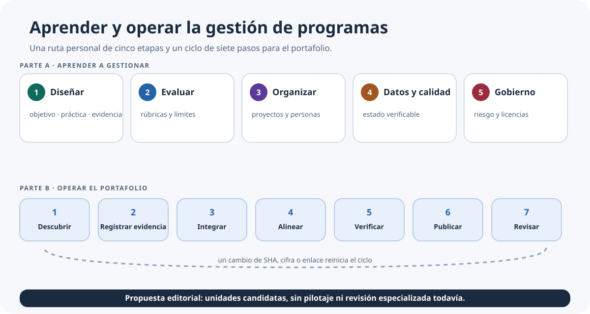

# Esquema de aprendizaje y gestión de programas

[← Centro documental](README.md) · [Atlas de roles](ROLES_ATLAS.md) · [Política de integración](INTEGRATION_POLICY.md) · [Atlas de programas](PROGRAM_ATLAS.md)

Este documento propone un esquema en dos partes:

- **Parte A — Aprender a gestionar programas.** Cómo una persona desarrolla las capacidades para coordinar, evaluar y sostener programas de aprendizaje, usando los programas ya integrados.
- **Parte B — Operar la gestión del portafolio.** Cómo se mantiene al día el conjunto de programas en este repositorio: descubrir, registrar, integrar, verificar, publicar y revisar.

Es una **propuesta editorial** del maestro. Las unidades que se mencionan son candidatas: se tomaron de índices y READMEs, no de una lectura de cada clase, y requieren selección, revisión humana y evidencia de uso antes de integrarse en una malla.

## Qué significa «gestionar un programa»

Gestionar un programa de aprendizaje es sostener, a lo largo del tiempo, la relación entre cinco cosas: **objetivos observables, fundamento, práctica, evidencia y continuidad**. No equivale a administrar archivos ni a contar clases. Cada programa conserva su numeración, su licencia y sus decisiones; quien lo gestiona desde aquí enlaza, registra y revisa, sin copiar cursos completos ni renombrar nada.

Se distinguen dos objetos de gestión:

| Objeto | Pregunta | Dónde se resuelve |
| --- | --- | --- |
| Un programa | ¿Está bien diseñado, evaluado y mantenido? | En su repositorio fuente |
| El portafolio de programas | ¿Qué existe, qué cambió, qué se sabe y qué falta? | En este maestro (Parte B) |

## Parte A — Aprender a gestionar programas

### Principios

- **Entrada por diagnóstico.** Se acredita lo que la persona ya domina mediante una tarea y una explicación; no se exige repetir unidades.
- **Reingreso permitido.** Después de una pausa se retoma desde la evidencia previa, sin penalización.
- **Prerrequisitos justificados.** Se distinguen los necesarios de los recomendados.
- **Autonomía y alternativas.** Cada etapa admite varias formas de evidencia: documento, tablero, presentación oral o simulación.
- **La edad no equivale a dominio.** La etapa vital, la competencia y el propósito se separan.

### Ruta de cinco etapas

| Etapa | Capacidad que se desarrolla | Programas y rutas candidatos | Evidencia posible |
| --- | --- | --- | --- |
| 1. Diseñar el aprendizaje | Relacionar objetivos, práctica, evidencia y retroalimentación | `PRG-PEDAGOGY`: partes 00–02 y 09–12; rutas de diseñador instruccional y jefe de UTP | Matriz objetivo–práctica–evidencia de un programa real |
| 2. Evaluar con criterio | Diseñar rúbricas, entender límites de la medición | `PRG-ASSESS`; ruta de especialista en evaluación de `PRG-PEDAGOGY`; rúbricas del maestro | Rúbrica con criterios, niveles y límites declarados |
| 3. Organizar proyectos y personas | Planificar, coordinar y entregar de forma iterativa | `PRG-LEADERSHIP`: módulos de gestión de personas y de proyectos y entrega ágil; roles Engineering Manager y Technical Lead de `PRG-SOFTWARE` | Plan de trabajo con hitos, responsables y criterios de salida |
| 4. Datos, calidad y documentación | Medir el estado real y mantener la documentación fiel | `PRG-DATA`; roles QA, Technical Writer y Compliance Engineer de `PRG-SOFTWARE` | Tablero de estado con fuentes y fechas |
| 5. Gobierno, riesgo y licencias | Decidir con evidencia, gestionar riesgos y respetar derechos | `PRG-LEADERSHIP` (riesgo, legal, compliance); ruta GRC de `PRG-CYBER`; políticas del maestro | Registro de riesgos y de licencias de un conjunto de programas |

Competencias del maestro relacionadas: `C-LEARN-01` a `C-LEARN-04`, `C-PROJ-01`, `C-COLLAB-01`, `C-TEACH-01`, `C-ASSESS-01`, `C-DATA-01`, `C-RES-01` y `C-ETH-01`. Las correspondencias son candidatas.

### Producto final propuesto

Un **expediente de gestión** de dos o tres programas, con: mapa de objetivos y evidencias, estado verificable con fechas, riesgos y licencias, plan de revisión y una decisión justificada sobre qué integrar y qué dejar como candidato.

### Continuidad

Cada etapa abre salidas, no un final: profundizar en evaluación, pasar a dirección de equipos, especializarse en datos o seguridad, o retomar más adelante. Las rutas por rol del [atlas](ROLES_ATLAS.md) muestran cómo continuar.

## Parte B — Operar la gestión del portafolio

### Ciclo

| Paso | Qué se hace | Salida | Herramienta |
| --- | --- | --- | --- |
| 1. Descubrir | Listar los repositorios públicos y detectar programas nuevos o cambiados | Registro de descubrimiento | API de GitHub; [descubrimiento](../catalog/REPOSITORY_DISCOVERY.md) |
| 2. Registrar evidencia | Leer el README, guardar URL, SHA y alcance de lectura | Entrada en `sources/evidence.json` | [Registro de fuentes](../sources/README.md) |
| 3. Integrar | Asignar ID `owner/name`, ficha, competencias candidatas y puntos de entrada | Entrada en `catalog/programs.json` y ficha | [Política de integración](INTEGRATION_POLICY.md) |
| 4. Alinear | Relacionar con mallas, rutas y roles solo con evidencia | Mallas, atlas y rutas | [Mallas](../curricula/README.md) |
| 5. Verificar | Validar datos, enlaces y pruebas | Resultado del validador y de las pruebas | `scripts/validate.py`, pruebas |
| 6. Publicar | Reconstruir el lector y comprobar su vigencia | Portal y CI en verde | `scripts/build_portal.py` |
| 7. Revisar | Repetir cuando algo cambie | Nota de continuidad | [Continuidad](../prompts/CONTINUITY.md) |

### Disparadores de revisión

| Disparador | Respuesta |
| --- | --- |
| Cambia el SHA del README de un programa | Releer, actualizar cifras, fecha y alcance de lectura |
| Aparece un repositorio educativo nuevo | Registrarlo como candidato; integrarlo solo con lectura y ficha |
| Cambia una cifra declarada | Actualizar catálogo, ficha, atlas, mapas y portal a la vez |
| Se rompe un enlace | Corregir o declarar el destino como no verificado |
| Se añade una afirmación nueva | Exigir fuente, fecha y alcance antes de publicarla |

Caso real: el 2026-11-24 nueve de los catorce README integrados habían cambiado de SHA y se encontró un programa nuevo (astronomía); el ciclo anterior se aplicó completo y quedó registrado.

### Funciones de gestión

Son funciones, no cargos. Una misma persona puede cumplir varias, y las revisiones humanas independientes no se reemplazan con automatización.

| Función | Responsabilidad | Roles de referencia en los programas |
| --- | --- | --- |
| Curaduría del catálogo | Decidir qué entra, con qué ID y estado | Diseñador instruccional; Solutions Architect |
| Revisión de evidencia | Contrastar cifras y alcance con la fuente | QA / Test Automation; Technical Writer |
| Revisión pedagógica y disciplinar | Evaluar calidad, adecuación y límites | Especialista en evaluación; investigador educativo; revisión especializada externa (pendiente) |
| Calidad y publicación | Validar, reconstruir y desplegar | Build & Release; DevOps |
| Gobierno y derechos | Licencias, datos personales y riesgos | Compliance Engineer; GRC |
| Dueño del programa | Mantener su contenido y numeración | Autoría del repositorio fuente |

### Reglas de conteo

- No se suman clases de programas distintos como si fueran equivalentes.
- Se separan OA, clases, laboratorios y experiencias transversales.
- «Redactado» no es «revisado» ni «aprendido»: se conserva el estado declarado por cada programa.
- Los [niveles de evidencia](ECOSYSTEM_MAP.md) (metadato, README, índice, unidad y relación verificada) no se promueven sin una comprobación nueva.

### Indicadores útiles y trampas

| Indicador | Uso | Trampa |
| --- | --- | --- |
| Programas con SHA vigente | Detecta deriva entre fuente y maestro | Un SHA igual no prueba calidad |
| Programas con ficha y puntos de entrada | Mide integración documental | No mide uso real |
| Enlaces locales comprobados | Evita navegación rota | No valida contenido de destino |
| Revisiones humanas completadas | Mide validación real | Hoy está pendiente en varios programas |
| Pilotajes con participantes | Evidencia de uso | No existe todavía en este maestro |

## Decisiones y límites

- Esta propuesta no implica que el maestro gestione los repositorios ajenos: solo enlaza y registra.
- No se afirma eficacia demostrada, acreditación ni habilitación profesional.
- La ruta de la Parte A no se ha piloteado con participantes ni ha recibido revisión especializada.
- El esquema reutiliza las herramientas existentes; no crea mecanismos nuevos.
- Cualquier cambio en otro repositorio forma parte de la tarea autorizada, no de este documento.
