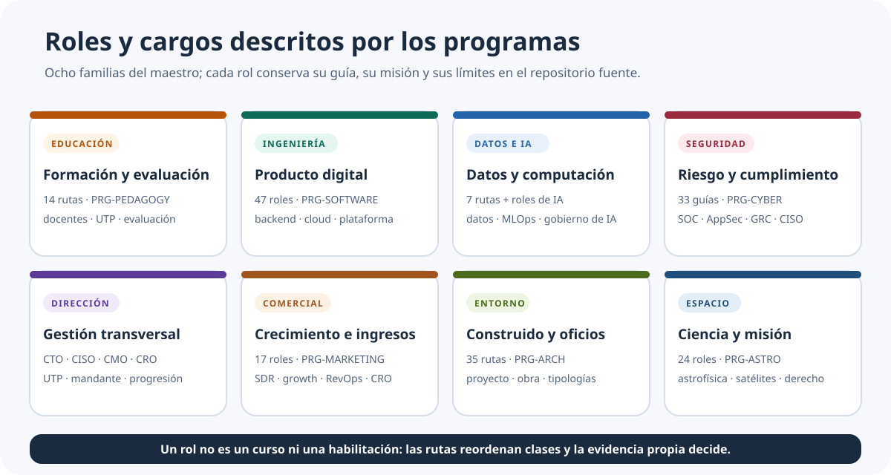

# Atlas global de roles y cargos

[← Centro documental](README.md) · [Atlas de programas](PROGRAM_ATLAS.md) · [Esquema de gestión de programas](PROGRAM_MANAGEMENT.md)

Varios programas del ecosistema organizan su contenido por **rol profesional**: publican guías, rutas y mapas de cargos dentro de su propio repositorio. Este atlas los reúne en una sola lectura para responder tres preguntas: qué roles están descritos, dónde está su guía y qué función cumple cada uno frente a los demás.

El atlas es una **lectura editorial del maestro**. Los nombres, las misiones y las rutas pertenecen a cada programa; aquí solo se enlazan, se agrupan y se señalan sus límites. No sustituye una guía de carrera, no describe ofertas ni remuneraciones y no otorga habilitación profesional.

## Cómo leer un rol

Un rol resuelto, dentro de esta guía, es un rol que su programa describe con estos elementos mínimos:

| Elemento | Pregunta que responde |
| --- | --- |
| Misión | ¿Qué problema profesional resuelve y qué no le corresponde? |
| Decisiones | ¿Qué decide la persona y qué entrega a otras? |
| Ruta | ¿Qué partes o clases del programa lo sostienen? |
| Evidencia | ¿Qué producto demuestra criterio y no solo exposición a herramientas? |
| Límites | ¿Qué credencial, normativa o autoridad externa se exige? |

Tres advertencias que los propios programas repiten:

- **Los títulos cambian entre organizaciones.** Una oferta puede llamar «Software Engineer» a un perfil backend o «Architect» a un perfil de liderazgo técnico. Importa la misión, no la etiqueta.
- **Un rol no es un curso.** Las rutas reordenan clases ya existentes; los roles no tienen clases propias ni suman programas separados.
- **Completar una ruta no concede un cargo, un título ni una certificación.** La edad, la etapa vital y el cargo previo tampoco equivalen a dominio: el reingreso y el reconocimiento de saberes previos se hacen con evidencia.

## Panorama por programa

Conteos de guías observados el 2026-11-24 en el directorio o el índice de cada programa. Son conteos de archivos y filas de índice, no una auditoría de contenido; algunas guías son familias que agrupan variantes.

| Programa | ID | Guías | Naturaleza de la ruta | Índice |
| --- | --- | ---: | --- | --- |
| Ingeniería de software | `PRG-SOFTWARE` | 47 | Roles de ingeniería y liderazgo, con familia y misión | [roles](https://github.com/vladimiracunadev-create/modern-software-engineering-program/blob/main/roles/README.md) |
| Ciberseguridad | `PRG-CYBER` | 33 | Roles técnicos, de gestión y de gobierno; incluye guías de familia | [rutas](https://github.com/vladimiracunadev-create/modern-cybersecurity-program/blob/main/rutas/README.md) |
| Marketing, ventas y growth | `PRG-MARKETING` | 17 | Cargos comerciales y de ingresos, de analista a CRO | [rutas](https://github.com/vladimiracunadev-create/marketing-sales-growth-evolution-program/blob/main/rutas/README.md) |
| Pedagogía y ciencias del aprendizaje | `PRG-PEDAGOGY` | 14 | Cargos de enseñanza, evaluación, gestión escolar e investigación | [rutas](https://github.com/vladimiracunadev-create/education-pedagogy-learning-sciences-program/blob/main/rutas/README.md) |
| Astronomía y ciencias espaciales | `PRG-ASTRO` | 24 | Roles profesionales que reutilizan las mismas clases | [rutas](https://github.com/vladimiracunadev-create/astronomy-astrophysics-space-sciences-aerospace-engineering-learning-program/blob/main/rutas/README.md) |
| Arquitectura y entorno construido | `PRG-ARCH` | 35 | Mezcla de perfiles, tipologías y encargos | [rutas](https://github.com/vladimiracunadev-create/architecture-built-environment-learning-program/blob/main/docs/RUTAS_DE_APRENDIZAJE.md) |
| Bases de datos | candidato | 7 | Rutas por rol de datos | [rutas](https://github.com/vladimiracunadev-create/database-systems-labs/blob/main/rutas/README.md) |

Otros programas organizan por persona o por nivel, no por cargo:

- **`PRG-LEADERSHIP`** avanza por responsabilidad: de liderar sin cargo formal a dirigir una empresa, integrar un directorio y fundar.
- **`PRG-DATA`** ofrece documentos de entrada por perfil de uso (docente, alumno, producto, operación), no cargos de carrera.
- **`PRG-SCHOOL`** se ordena por nivel escolar, con electivos y especialidades técnico-profesionales.
- **`machine-operator-program`** (candidato) define un módulo por máquina, orientado a quien opera.

Suman 177 guías de ruta en los siete índices por rol, con superposición entre ellas: no son 177 cargos distintos.

## Familias globales

Las familias siguientes son una **taxonomía propia del maestro** para orientar la lectura. No reemplazan la clasificación interna de cada programa.

### 1. Educación y formación

Fuente principal: `PRG-PEDAGOGY`, con apoyo de `PRG-ASSESS`.

| Rol | Misión resumida |
| --- | --- |
| Educadora de párvulos | Acompañar aprendizaje en primera infancia |
| Docente de educación básica / media | Enseñar a lectores y adolescentes y sostener hábitos de estudio |
| Docente técnico-profesional / universitario | Enseñar un oficio o una disciplina en educación superior |
| Educador diferencial | Diseñar apoyos y ajustes para la diversidad de aprendizajes |
| Formador de adultos / de formadores | Formar a personas adultas y a quienes forman |
| Diseñador instruccional | Convertir objetivos en secuencia, práctica y evidencia |
| Especialista en evaluación | Hacer defendibles los instrumentos y sus usos |
| Especialista en IA educativa | Decidir qué hacer con la IA en el aula y su evaluación |
| Investigador educativo | Investigar la propia práctica con método |
| Jefe de UTP / director escolar | Conducir equipos e instituciones educativas |

### 2. Ingeniería y producto digital

Fuente principal: `PRG-SOFTWARE`; apoyo de las rutas de bases de datos.

| Familia interna | Roles |
| --- | --- |
| Ingeniería general y producto | Software Engineer, Systems Programmer, Backend, Frontend y Full-stack Engineer |
| Clientes y sistemas físicos | Mobile, Desktop, Embedded & IoT y Safety-Critical Software Engineer |
| Interfaces, calidad e inclusión | API, QA / Test Automation, Performance, Accessibility e Internationalization Engineer |
| Entrega y plataforma | DevOps, Build & Release, Cloud, Platform y Developer Experience Engineer |
| Confiabilidad | Site Reliability, Observability, Distributed Systems y Chaos & Resilience Engineer |
| Evolución y conocimiento | Legacy Modernization, Technical Writer, Open Source & InnerSource Engineer |
| Diseño y producto técnico | Software Architect, Solutions Architect, Technical Product Engineer, SaaS / Product Platform Engineer |

### 3. Datos, IA y ciencia computacional

Fuentes: `PRG-SOFTWARE` (Data Engineer, Database Reliability Engineer, MLOps, AI Systems, AI Governance, AI-Augmented y Agentic Harness Engineer), las siete rutas de datos y `PRG-ASTRO` (matemática y computación científica espacial).

### 4. Seguridad, riesgo y cumplimiento

Fuente principal: `PRG-CYBER`, con Security y Compliance Engineer de `PRG-SOFTWARE`.

| Familia interna | Roles |
| --- | --- |
| Ofensiva e investigación | Pentester, Red Team, analista de seguridad ofensiva, investigador de seguridad, divulgación responsable |
| Defensa y operación | SOC / Blue Team, SecOps, DFIR, gestión de vulnerabilidades, Threat Intelligence |
| Seguridad del producto | AppSec, DevSecOps, Cloud Security, Game Security e Integrity |
| Gobierno | GRC, CISO y sus variantes (vCISO, Field CISO, BISO, Product CISO, AI CISO, OT CISO) |
| Infraestructura | Jefatura de infraestructura de ciberseguridad, plataformas DLP, arquitectura IT/OT |

### 5. Dirección y gestión

Es una familia transversal: aparece en casi todos los programas con otro nombre.

| Programa | Cargos de dirección o gestión |
| --- | --- |
| `PRG-SOFTWARE` | Engineering Manager, Staff / Principal / Technical Lead, CTO |
| `PRG-CYBER` | CISO y variantes, jefatura de infraestructura |
| `PRG-MARKETING` | Head of GTM, CMO, VP de ventas, CRO, Founder |
| `PRG-PEDAGOGY` | Jefe de UTP, director escolar |
| `PRG-ARCH` | Mandante informado, gestión de proyectos y obra, desarrollo inmobiliario |
| `PRG-LEADERSHIP` | Progresión de responsabilidad: sin cargo, líder, directivo, directorio, fundador |

### 6. Comercial, crecimiento y operación de ingresos

Fuente: `PRG-MARKETING`.

| Familia interna | Roles |
| --- | --- |
| Marketing | Marketing manager, Product marketing, Brand manager, Content manager |
| Growth y adquisición | Growth manager, Performance marketer, E-commerce manager |
| Ventas | SDR / BDR, Ejecutivo comercial |
| Retención y operación | Customer Success, RevOps |
| Analítica | Analista de marketing y de ingresos |

### 7. Entorno construido y oficios

Fuente: `PRG-ARCH` (35 rutas) y `machine-operator-program`. Las rutas de arquitectura combinan perfiles (proyecto integral, gestión de obra, mandante informado, corredor de propiedades), especialidades (estructura, envolvente, acústica, iluminación, BIM) y tipologías (vivienda, salud, educación, transporte, centros de datos). Diseñar o intervenir una obra real exige antecedentes y revisión profesional que este repositorio no proporciona.

### 8. Espacio, ciencia y misión

Fuente: `PRG-ASTRO`, con 24 roles agrupados por campo:

| Campo | Roles |
| --- | --- |
| Ciencia | Astrofísica estelar y galáctica; cosmología; ciencias planetarias; astroquímica y astrobiología; heliofísica y clima espacial; radioastronomía |
| Instrumentación y observación | Ingeniería óptica y telescopios; observación terrestre y geointeligencia |
| Vuelo y misión | Astrodinámica; navegación y autonomía; lanzadores y propulsión; satélites y CubeSats; aviónica y software; materiales y térmica; telecomunicaciones; robótica espacial |
| Personas y hábitats | Astronáutica tripulada; medicina y bioingeniería espacial; arquitectura y hábitats |
| Entorno y sociedad | Derecho, políticas y negocios espaciales; recursos y economía; seguridad y resiliencia de infraestructuras; educación y divulgación |

## Matriz transversal por función

La misma función profesional aparece con nombres distintos según el campo. Esta matriz permite pasar de un programa a otro sin asumir equivalencia: dos roles de una fila comparten una función, no una responsabilidad ni un nivel.

| Función | Software y datos | Seguridad | Comercial | Educación | Entorno y espacio |
| --- | --- | --- | --- | --- | --- |
| Dirección | CTO, Engineering Manager | CISO | CMO, CRO, VP de ventas | Director escolar, Jefe de UTP | Mandante informado |
| Producto y diseño de solución | Technical Product Engineer, Solutions Architect | Product CISO | Product marketing | Diseñador instruccional | Proyecto arquitectónico integral |
| Operación y confiabilidad | SRE, DevOps, Platform | SecOps, SOC | RevOps, Customer Success | Gestión de aula | Operación y rehabilitación; estaciones terrestres |
| Calidad y evidencia | QA, Performance, Accessibility | Gestión de vulnerabilidades | Analista de marketing | Especialista en evaluación | Control de calidad de obra; verificación |
| Gobierno, riesgo y cumplimiento | Compliance, AI Governance | GRC | Licitud de contacto y datos | Credenciales y carrera docente | Derecho y políticas espaciales |
| Datos y análisis | Data Engineer, MLOps | Threat Intelligence | RevOps, analítica | Evaluación con datos | Computación científica; BIM |
| Conocimiento y comunicación | Technical Writer | Divulgación responsable | Content manager | Formador de formadores | Educación y divulgación astronómica |
| Investigación | Distributed Systems, Systems Programmer | Investigador de seguridad | Growth (experimentación) | Investigador educativo | Investigación y academia; ciencias planetarias |

## Roles de nombre parecido y responsabilidad distinta

Los programas advierten de estas confusiones. Se reproducen como criterio de lectura, no como definiciones nuevas.

| Par o grupo | Qué los distingue según la fuente |
| --- | --- |
| CISO, Field CISO, vCISO, BISO, Product CISO, AI CISO, OT CISO | Unos tienen mandato interno; otros asesoran desde un proveedor; otros son un modelo de contratación. La autoridad sobre el riesgo y el componente comercial cambian. Su ficha propone un test de ocho preguntas para saber si un cargo tiene mandato real |
| SOC, SecOps, DevSecOps, AppSec, Cloud Security | Se separan por lo que la persona hace cada día, qué decide y qué entrega, no por el título de la oferta |
| Software Engineer, Backend, Full-stack, Platform, DevOps | Cambian por responsabilidad, evidencia y decisiones de salida; las ofertas los mezclan |
| Product marketing, Marketing manager, Growth manager | Traducir producto en oferta, decidir dónde compite la empresa y experimentar sobre el recorrido completo |
| SDR / BDR, Ejecutivo comercial, Customer Success | Abrir conversaciones, responder por un cierre y asegurar que el cliente obtenga lo comprado |

## Qué roles quedan resueltos y cuáles no

| Estado | Criterio | Ejemplos |
| --- | --- | --- |
| Resuelto en origen | El programa publica guía con misión, ruta y evidencia | Los 47 roles de software, las rutas de marketing, pedagogía, astronomía y ciberseguridad |
| Resuelto como tipología o perfil | Hay ruta, pero describe un encargo o una especialidad más que un cargo | Rutas de arquitectura por tipología; niveles de `PRG-SCHOOL` |
| Resuelto por progresión | El programa describe una trayectoria de responsabilidad, no cargos | `PRG-LEADERSHIP` |
| Pendiente | No existe aún programa verificado | Derecho general, psicología, lectura y edición, actividades dirigidas al niño en primera infancia ([registros pendientes](../catalog/pending.json)) |

«Resuelto en origen» no significa «verificado por el maestro»: indica que el programa fuente lo describe. La revisión disciplinar y pedagógica humana sigue pendiente en los programas que lo declaran, y ninguna guía de rol prueba eficacia ni empleabilidad.

## Cómo usar este atlas

1. Parte de lo que quieres hacer, no del título del cargo: usa la misión y las decisiones.
2. Localiza la familia y abre la guía en el repositorio fuente.
3. Verifica los prerrequisitos y propón evidencia propia para reconocer saberes previos.
4. Para convertir una ruta en un plan, usa las [mallas](../curricula/README.md), las [rutas de uso](../pathways/README.md) y la [selección de unidades](../integrations/UNIT_SELECTION.md).
5. Para gestionar el conjunto de programas como portafolio, consulta el [esquema de gestión](PROGRAM_MANAGEMENT.md).

## Límites

- Los conteos y listas provienen de índices y directorios observados; no se leyó cada guía.
- Las familias globales son del maestro; las equivalencias entre roles de programas distintos son candidatas y requieren lectura de unidades.
- Ninguna guía otorga título, licencia, certificación ni habilitación para ejercer.
- El currículo para formadores no se presenta como currículo del niño.
